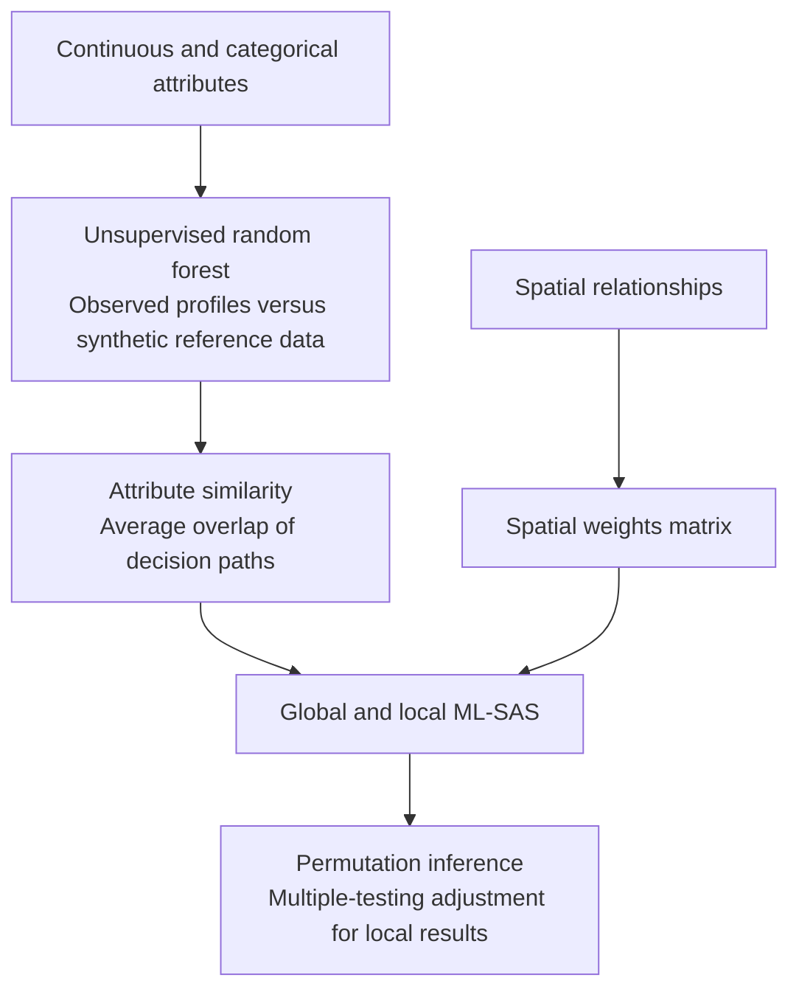

# ml-sas-paper

Reproduction code for **ML-SAS: A Machine-Learning-Based Spatial Autocorrelation
Statistic for Mixed-Type Data**, by **Woohyung Kim and Sang-Il Lee**.

Published online on 9 October 2026 in *Geographical Analysis*.

Kim, W., & Lee, S.-I. (2026). ML-SAS: A Machine-Learning-Based Spatial Autocorrelation Statistic for Mixed-Type Data. *Geographical Analysis*, **58**(4), e70062. https://doi.org/10.1111/gean.70062

## Research question

**Are neighboring places also similar in their joint attribute profiles, when
those profiles combine continuous and categorical variables?**

ML-SAS addresses this question by learning attribute similarity with an
unsupervised random forest and comparing it with spatial proximity. It provides
global and local spatial autocorrelation statistics for continuous, categorical,
and mixed-type data. The paper evaluates how this representation changes spatial
pattern detection through controlled simulations and an application to Dutch
municipalities.

For applying the method to your own data, see the separate
[ml-sas-r package](https://github.com/geowhk/ml-sas-r) and its
[usage tutorial](https://geowhk.github.io/ml-sas-r/getting-started.html).
This repository contains the paper's experiments, DGP code, selected reference
results, and table and figure reproduction workflows.

## How ML-SAS works



1. **Learn attribute similarity.** Synthetic reference observations are sampled
   independently from each attribute's observed marginal distribution (Addcl1).
   A forest distinguishes observed from synthetic profiles. For each pair of
   observed units, path proximity averages the Jaccard overlap of their complete
   root-to-terminal paths across trees.
2. **Combine attribute and spatial relationships.** The learned similarity matrix
   and spatial weights enter a generalized matrix-correlation statistic, with
   self-pairs excluded. Global ML-SAS has expectation **1 under spatial
   randomization**; values above 1 indicate greater neighbor similarity than
   expected. The average of the local statistics equals the global statistic.
3. **Assess departures from randomization.** The empirical analysis uses total
   randomization globally and focal conditional randomization locally, with
   rank-based permutation tests and Benjamini–Hochberg adjustment for local
   multiple testing. Analytical randomization moments are derived in Appendix A.

A local similarity cluster can involve moderate values or a mixed attribute
profile; it is not restricted to univariate High–High or Low–Low patterns.
Local significance and its direction are assessed against the relevant
permutation distribution, not simply by comparing a local value with 1.

## Main findings

| Question | Finding in the paper | Evidence |
|---|---|---|
| Does ML-SAS track familiar global spatial patterns? | Across common spatial arrangements, correlations were 0.473 with Moran's I, −0.468 with Geary's c, and 0.874 with the BB join count. The statistics are related, not numerically equivalent. | Figures 1–2 |
| How sensitive is the learned similarity to forest settings? | Path-based ML-SAS varied less than terminal-node ML-SAS across the tested splitting and stopping settings. | Figures 3–4 |
| How often does the procedure reject under the spatial null? | Both path specifications rejected at least one location in 4 of 100 null datasets: probability 0.040, exact 95% CI 0.011–0.099. | Table 2 |
| What changes in the continuous multivariate design? | ML-SAS had lower background false-positive proportions and higher conditional precision and rank AUC, but lower recall and F1 than Multivariate Local Geary. | Table 3; Figure 6 |
| What does adding a nominal attribute change? | In the nonlinear mixed-type design, path ML-SAS recall rose from 0.395 to 0.618 and F1 from 0.546 to 0.744. Background false positives increased slightly and rank AUC fell from 0.968 to 0.934; gains favored the prevalent target category, while uncommon categories lost detections. | Table 4; Figure 7; Tables C2–C3 |
| Does the attribute representation matter in real data? | Adding ordered urbanity changed 23 municipal classifications: 17 gained similarity-cluster status and six lost it. | Figure 9 |

These results support ML-SAS as a complementary representation of spatial
association. They do not establish uniform superiority over distance-based
statistics: Multivariate Local Geary retained higher mean recall and F1 in the
reported continuous component of the nonlinear mixed-type design as well.

### Empirical application: Dutch municipalities

The application uses **337 municipalities** from the 2022 `tmap::NLD_muni` dataset,
with row-standardized queen-contiguity weights. The continuous baseline contains
population, average assessed dwelling value, and employment rate. The mixed
specification adds five-level **ordered urbanity**.

| Result | Continuous baseline | With ordered urbanity |
|---|---:|---:|
| Global ML-SAS | 1.245 | 1.291 |
| Similarity clusters | 44 | 55 |
| Dissimilarity/outliers | 1 | 1 |
| Nonsignificant municipalities | 292 | 281 |

Both global tests gave a two-sided permutation p-value of 0.00002. Local results
use 99,999 focal conditional permutations and Benjamini–Hochberg adjustment at
0.05. The comparison describes two fitted attribute representations; the change
in global values is not itself a test of the effect of urbanity.
See the [global results](reference/empirical/tables/global_mlsas.csv) and
[local specification comparison](reference/empirical/tables/continuous_vs_mixed_local.csv).

## Navigate the research and its reproduction

The simulation experiments use a **400-cell hexagonal lattice**. DGP 1 illustrates
homogeneous regions at different attribute levels; DGPs 2–4 evaluate a spatial
null, a continuous multivariate target, and a nonlinear mixed-type target.
DGPs 2–4 each have **100 independently generated datasets**. Representative maps
show individual realizations; repeated results quantify operating characteristics.

| Research component | Repository location | Paper items |
|---|---|---|
| Representative spatial processes and local comparisons | [Simulation workflows](02_revision-simulation/) | Figures 5–7 and B1 |
| Forest settings and path versus terminal proximity | [Sensitivity workflows](03_hyperparameter-sensitivity/) | Figures 3–4 |
| Comparison with established global statistics | [Global benchmarks](04_current-statistics-comparison/) | Figures 1–2 |
| Repeated null and detection experiments | [Repeated simulation specification and runners](analysis/repeated/) | Tables 1–4 |
| Dutch municipal application | [Empirical workflows](05_empirical-study/) | Figures 8–9; Section 5 |
| Stored results and figure inputs | [Reference data](reference/) | Saved-result reproduction and Appendix C diagnostics |

The [reproduction guide](docs/REPRODUCING.md#outputs-and-paper-mapping) maps paper
items to generated output files. The commands below provide a quick saved-result
replay and a full recomputation route.

### Scope of the evidence

The study tests low-dimensional inputs (at most four attributes), one simulation
lattice size, and one national municipal dataset. Results depend on input
encoding, spatial weights, synthetic reference construction, and forest settings.
The full pairwise similarity matrix requires storage that grows quadratically
with the number of spatial units. Category imbalance also matters, as the DGP 4
diagnostics show. Broader spatial supports and high-dimensional performance were
not established by these experiments.

## Getting started

The checked environment uses **R 4.5.2 and Python 3.13**. R dependencies are pinned
in `renv.lock`; Python dependencies are listed in
`environment/requirements-figures.txt`. The commands below use a macOS/Linux shell.
The paper workflow has been checked on macOS; the R package's cross-platform
checks do not cover this separate reproduction workflow.

```sh
git clone https://github.com/geowhk/ml-sas-paper.git
cd ml-sas-paper
Rscript scripts/setup.R
python3 -m venv .venv
.venv/bin/python -m pip install -r environment/requirements-figures.txt
```

See [installation requirements](docs/INSTALL.md) for compilers and spatial libraries.

## Reproduce the results

**Quick check using saved results:** regenerates final summaries, Appendix C
diagnostics and ten figures without refitting the models.

```sh
.venv/bin/python scripts/reproduce.py --mode saved --out runs/saved
```

**Full recomputation:** reruns models, inference, simulations and sensitivity
analyses before assembling and comparing the final results.

```sh
.venv/bin/python scripts/reproduce.py --mode full --out runs/full --workers 1 --parallelism 1
```

The original research used **AWS**. Full recomputation can take hours to days
and requires adequate memory and uninterrupted runtime; start with saved mode
on a personal computer. See [runtime and resource guidance](docs/RUNTIME.md).
Add `--resume` to the same full command to resume an interrupted run.

The [reproduction guide](docs/REPRODUCING.md) gives stage details, output locations
and mappings to the paper's tables and figures.

## Validation

Saved-result reproduction, the full empirical analysis and one repeated-simulation
replication have been checked against the final v6 results. The entire 300-dataset
simulation batch and complete sensitivity grids have **not** been rerun during
this release preparation. See [validation scope](docs/RELEASE_STATUS.md).

## Authors and license

Woohyung Kim and Sang-Il Lee. Contact: whk3423@snu.ac.kr.

Project code is available under the [MIT license](LICENSE). Upstream dependencies
and data retain their own terms; see [sources and attribution](docs/THIRD_PARTY.md).
